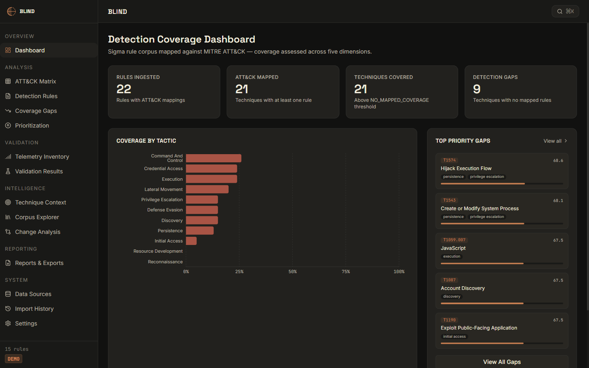
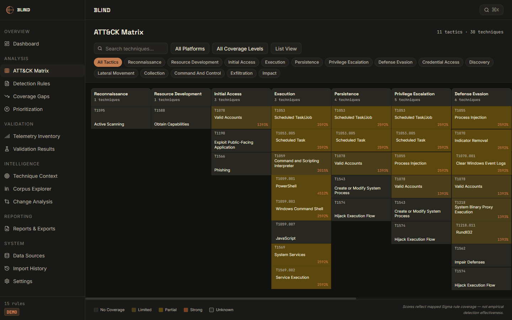
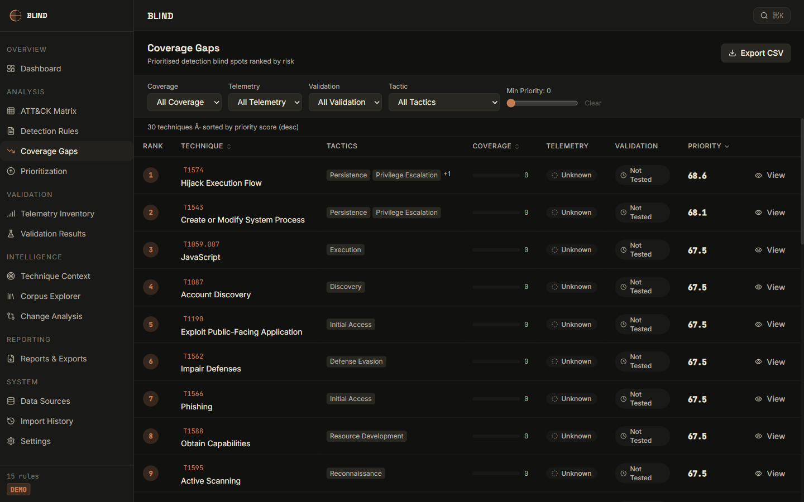
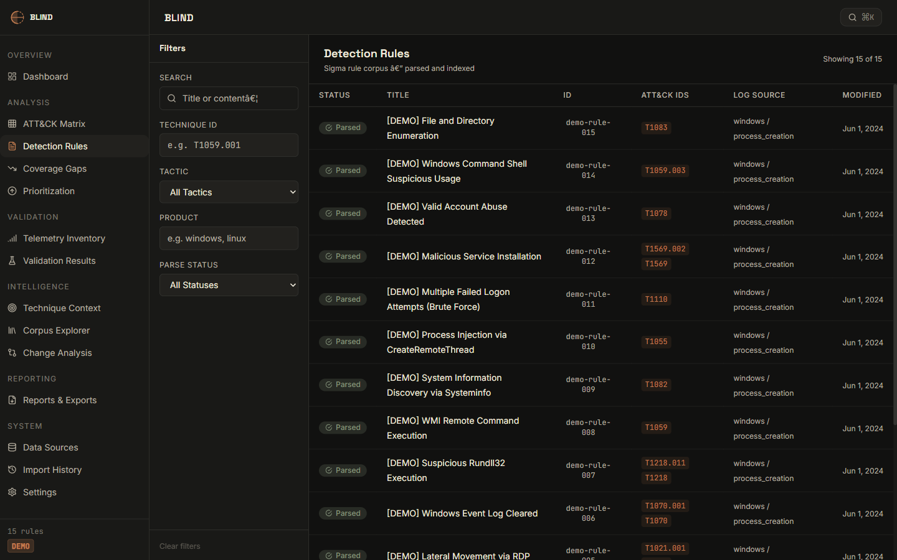
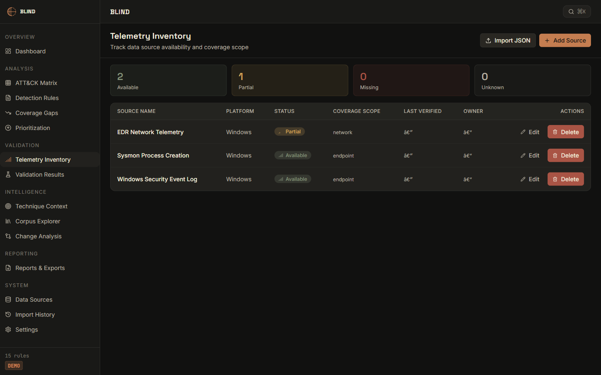
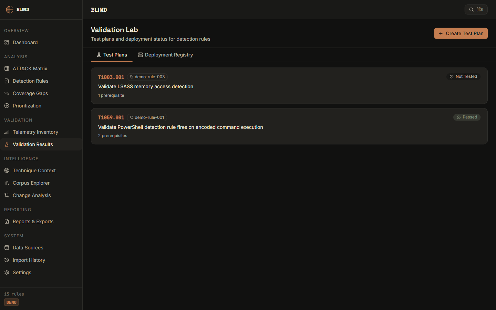
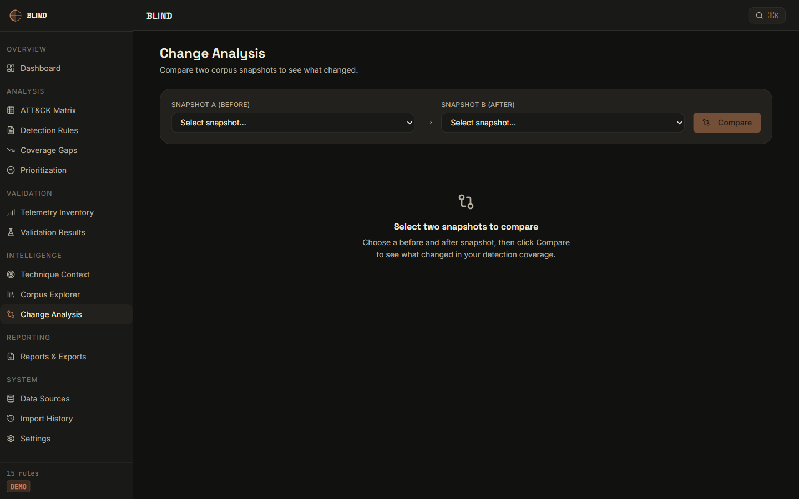
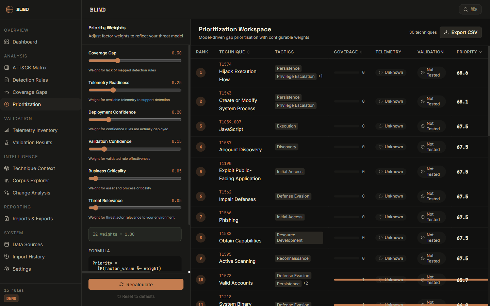

<div align="center">



# BLIND

**Detection Coverage Intelligence Platform**

> *You can't secure what you can't see. BLIND tells you exactly what MITRE ATT&CK techniques your Sigma rules actually cover — and which ones leave you blind.*

[](https://www.python.org/)
[](https://fastapi.tiangolo.com/)
[](https://react.dev/)
[](https://www.typescriptlang.org/)
[](https://attack.mitre.org/)
[](LICENSE)

</div>

---

## What Is BLIND?

Security teams measure detection coverage by **rule count**. That number is almost always wrong.

Rules get ingested, de-duplicated, and forgotten. What actually matters is: for each ATT&CK technique an adversary might use, does your Sigma corpus provide **meaningful detection confidence**? BLIND answers that question.

BLIND ingests your Sigma rule corpus, extracts `attack.technique` tags, maps every rule to its corresponding ATT&CK technique, and scores coverage across five weighted dimensions: **rule count**, **logic quality**, **platform breadth**, **telemetry availability**, and **validation status**. The result is a prioritised gap list your blue team can act on.

### Why BLIND?

| What other tools do | What BLIND does |
|---|---|
| Count rules per tactic | Score *actual detection confidence* per technique |
| Show a heat map | Surface *ranked gaps* with actionable context |
| Require cloud connectivity | Run entirely offline on your own data |
| Export a static PDF | Provide an interactive, filterable research platform |

---

## Screenshots

<details open>
<summary><strong>Detection Coverage Dashboard</strong></summary>


*Animated metric counters, coverage-by-tactic Recharts bar chart, and top-priority gaps — all driven by live API data.*

</details>

<details>
<summary><strong>ATT&CK Matrix</strong></summary>



*Full MITRE ATT&CK matrix with colour-coded coverage cells (Strong / Partial / Limited / No Coverage), tactic-filter tabs, list/grid toggle, and animated hover cards showing per-technique details.*

</details>

<details>
<summary><strong>Coverage Gaps</strong></summary>



*Ranked gap table with multi-dimensional filters (coverage level, telemetry, validation, tactic), priority score, CSV export, and one-click technique detail.*

</details>

<details>
<summary><strong>Detection Rules</strong></summary>



*Full Sigma corpus table with stagger-animated row entrance, live search, status/severity/tactic filters, and technique tag chips.*

</details>

<details>
<summary><strong>Telemetry Inventory</strong></summary>



*Data source registry — track which log sources feed which ATT&CK data components and which techniques become visible.*

</details>

<details>
<summary><strong>Validation Lab</strong></summary>



*Purple-team validation records — log detection test results per technique, track PASSED / FAILED / NOT\_TESTED state, and use validation scores in the coverage calculation.*

</details>

<details>
<summary><strong>Change Analysis</strong></summary>



*Snapshot comparison — diff coverage scores between any two corpus snapshots to prove (or disprove) that a rule update actually improved detection posture.*

</details>

<details>
<summary><strong>Prioritization Engine</strong></summary>



*Interactive weight sliders that recalculate the composite priority formula in real-time — tune the balance between coverage, telemetry, and validation to match your organisation's risk profile.*

</details>

---

## Features

### Analysis Engine (Python)
- **Sigma parser** — extracts ATT&CK tags (`attack.tN`, `attack.tN.NNN`, `attack.subtechnique`) from YAML rule files, directories, or the demo corpus
- **ATT&CK STIX ingestion** — parses `enterprise-attack.json` bundles to build the full technique/sub-technique/tactic graph
- **Coverage scorer** — five-dimensional score per technique: rule count, logic quality, platform breadth, telemetry availability, validation status
- **Gap prioritizer** — composite priority score combining threat relevance, data-source availability, and coverage deficit
- **SQLite persistence** — all results stored in `~/.blind/blind.db` with thread-safe async access

### Backend (FastAPI)
- Full REST API with async ingestion jobs, job progress tracking, and background task execution
- Path-validated file/directory ingestion with concurrent-ingest guard (409 if already running)
- CORS restricted to localhost dev ports; security headers on every response (CSP, DENY framing, no-referrer)
- Body size limit middleware (10 MB); detailed exception logging with type-only leakage to clients
- Navigator JSON export, CSV export, and gap/rule JSON exports

### Frontend (React + TypeScript + Vite)
| Page | Highlights |
|---|---|
| **Dashboard** | Animated counters (Framer Motion), Recharts tactic bar chart, critical-gap cards |
| **ATT&CK Matrix** | 11-tactic grid, coverage-level colour cells, animated hover cards with per-technique detail |
| **Detection Rules** | Stagger-animated table rows, live search, status/severity filters |
| **Coverage Gaps** | Filterable ranked table, animated priority bars, CSV export |
| **Prioritization** | Weight sliders, live formula preview |
| **Telemetry Inventory** | Data-source registry with technique mapping |
| **Validation Lab** | Purple-team result tracker |
| **Change Analysis** | Snapshot diff — baseline vs. updated corpus |
| **Corpus Explorer** | Browse ingested corpora |
| **Data Sources** | Ingest new Sigma directories or trigger demo load |

---

## Architecture

```
blind/
├── blind_engine/               # Pure-Python analysis engine
│   ├── sigma/parser.py         # Sigma YAML → SigmaRule models
│   ├── attack/parser.py        # STIX JSON → AttackDataset
│   ├── mapping/mapper.py       # Rules × Techniques → RuleMapping[]
│   ├── coverage/scorer.py      # Coverage score per technique
│   ├── prioritization/engine.py# Gap priority ranking
│   ├── ingestion/demo.py       # 15-rule demo corpus (no files needed)
│   └── db/dal.py               # Async SQLite DAL (aiosqlite)
│
├── apps/
│   ├── api/                    # FastAPI application
│   │   ├── main.py             # CORS, middleware, router registration
│   │   ├── routes/             # ingest, rules, coverage, gaps, telemetry …
│   │   └── services/analysis.py# AnalysisState singleton
│   │
│   └── web/                    # React + TS + Vite frontend
│       └── src/
│           ├── features/       # Page-level feature modules
│           ├── components/ui/  # Shared UI primitives (AnimatedCounter …)
│           └── lib/api.ts      # Axios client
│
└── tests/                      # pytest suite
```

**Data flow:**

```
Sigma YAML files / demo corpus
        ↓  blind_engine/sigma
    SigmaRule[]  ──────────────────────────────── SQLite
        ↓  mapping/mapper
    RuleMapping[]
        ↓  coverage/scorer
    CoverageResult[] ──────────────────────────── SQLite
        ↓  prioritization/engine
    GapAssessment[] ───────────────────────────── SQLite
        ↓  FastAPI /api/*
    JSON REST responses ──── React UI ──── User
```

---

## Getting Started

### Prerequisites

| Tool | Version |
|---|---|
| Python | 3.11+ |
| Node.js | 18+ |
| npm | 9+ |

### Installation

```bash
git clone https://github.com/het-P301204/blind.git
cd blind

# Python engine + API
pip install -e ".[dev]"

# Frontend
cd apps/web
npm install
```

### Running

**Backend** (from project root):
```bash
python -m uvicorn apps.api.main:app --host 127.0.0.1 --port 8001 --reload
```

**Frontend** (from `apps/web/`):
```bash
npm run dev
```

Open **http://localhost:5179** and click **Explore Demo** to load the built-in 15-rule demo corpus.

### Using Your Own Rules

1. Navigate to **Data Sources**
2. Enter the path to your Sigma rule directory
3. Optionally load a MITRE ATT&CK STIX bundle (enterprise-attack.json) first
4. Click **Ingest** and watch progress in real time

---

## Demo Dataset

BLIND ships with a synthesised 15-rule Sigma corpus that requires no external files:

| Rule | Technique | Severity |
|---|---|---|
| PowerShell Empire Detection | T1059.001 | High |
| Mimikatz LSASS Access | T1003.001 | Critical |
| Net User Enumeration | T1087.001 | Medium |
| PsExec Remote Execution | T1569.002 | High |
| WMI Lateral Movement | T1047 | High |
| Schtasks Persistence | T1053.005 | Medium |
| Reg.exe AutoRun Key | T1547.001 | Medium |
| LOLBIN Proxy Execution | T1218 | Medium |
| Kerberoasting SPN Query | T1558.003 | High |
| DCSync via Replication | T1003.006 | Critical |
| … and 5 more | Various | Various |

The demo also includes 3 telemetry sources, 2 validation records, and 2 coverage snapshots for the Change Analysis page.

---

## Security

BLIND is a **research and defensive tooling platform** intended for use by blue teams on data they own.

- FastAPI backend binds to `127.0.0.1` only — not exposed to the network by default
- All file paths are validated with `pathlib.Path.resolve()` to prevent traversal
- Concurrent ingestion is guarded with an `_ingesting` flag (409 if already running)
- Request bodies are limited to 10 MB
- Error messages sent to clients contain only the exception type, not the full traceback
- Security headers: `X-Content-Type-Options: nosniff`, `X-Frame-Options: DENY`, `Referrer-Policy: no-referrer`

---

## Tech Stack

| Layer | Technology |
|---|---|
| Analysis engine | Python 3.11, pydantic, aiosqlite, PyYAML |
| Backend API | FastAPI 0.111, uvicorn, starlette |
| Frontend | React 18, TypeScript 5, Vite 5 |
| UI library | Tailwind CSS, Framer Motion 10, Recharts |
| State management | TanStack Query v5 |
| Database | SQLite (via aiosqlite) |
| Testing | pytest, pytest-asyncio |

---

## Testing

```bash
# Run full test suite
pytest

# With coverage
pytest --cov=blind_engine --cov-report=term-missing
```

The test suite covers the Sigma parser, ATT&CK STIX parser, coverage scorer, gap prioritizer, SQLite DAL, and all FastAPI endpoints.

---

## License

MIT — see [LICENSE](LICENSE).

---

<div align="center">

Built for blue teams who need to know what they're missing.

**BLIND** — because detection gaps you can't see are the ones that hurt.

</div>
